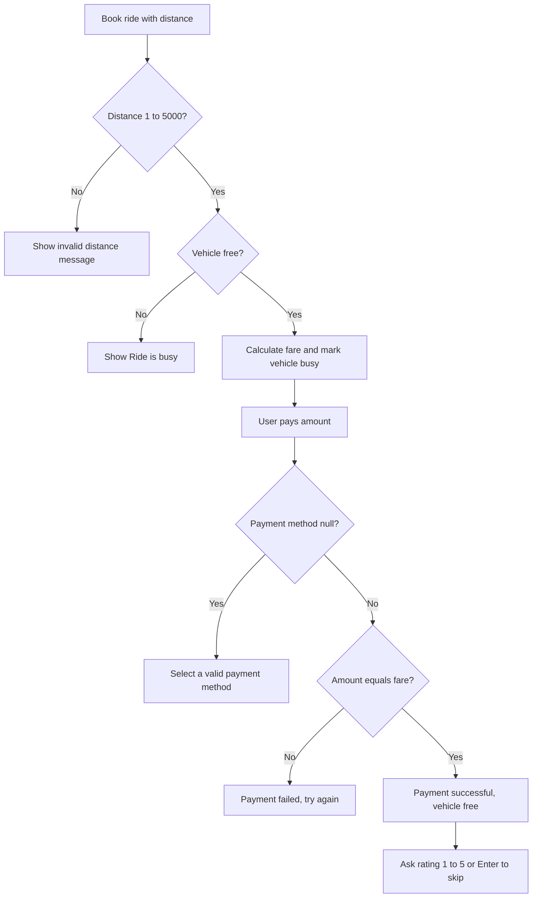
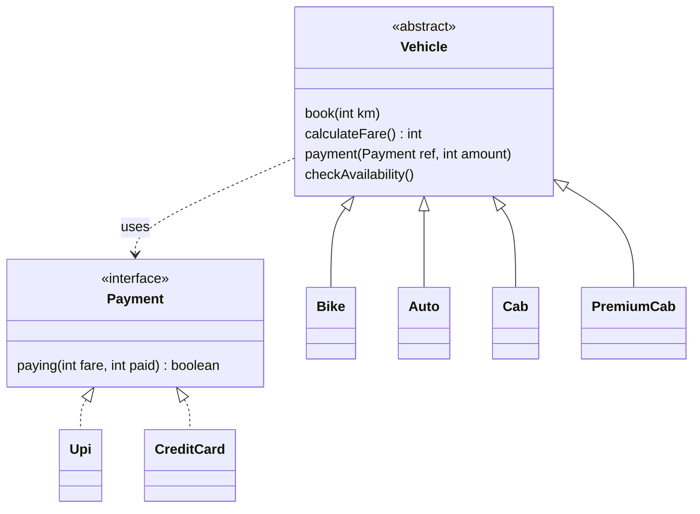

# QuickRide

A console-based ride booking system built in core Java using object-oriented programming. Users can book a Bike, Auto, Cab or Premium Cab, get the fare instantly, pay through Upi or Credit Card, and rate the ride.

## Version
v1.0, first stable release.

## Requirements
- Java 25 (the project uses `IO.println`, which is available only in newer Java versions)
- Any Java IDE such as Eclipse or IntelliJ

## Features
- Four vehicle types: Bike, Auto, Cab and PremiumCab.
- Fare calculation based on distance, rate per km and 12% tax.
- Premium Cab adds an extra premium charge per km.
- Booking limit of 5000 km per ride.
- Ride status tracking: a vehicle cannot be booked again until the current ride is paid.
- Payment through Upi or CreditCard using a common Payment interface.
- Ride rating from 1 to 5 after payment, or press Enter to skip.
- Input handling for invalid distance, wrong payment amount, null payment method and invalid rating.

## Rates
| Vehicle | Rate per km |
|---|---|
| Bike | 15 |
| Auto | 21 |
| Cab | 30 |
| PremiumCab | 30 plus 30 premium charge per km |

All fares include 12% tax.

## Ride Flow

## Design

## OOP Concepts Used
- **Abstraction:** Vehicle is an abstract class and Payment is an interface.
- **Inheritance:** Bike, Auto, Cab and PremiumCab extend Vehicle.
- **Polymorphism:** PremiumCab overrides calculateFare(), and payments work through the Payment reference.
- **Encapsulation:** Fields and internal methods like state and rating are private.

## Project Structure
- Vehicle.java: abstract parent class with booking, fare, payment and rating logic.
- Bike.java, Auto.java, Cab.java, PremiumCab.java: vehicle types.
- Payment.java: payment interface.
- Upi.java, CreditCard.java: payment implementations.
- QuickRideApp.java: main class to run the app.

## How to Run
1. Make sure Java 25 is installed.
2. Clone the repository.
3. Open it in your IDE.
4. Run QuickRideApp.java.

## Sample Flow
1. Book a ride with a distance in km and see the fare.
2. Check availability: the vehicle shows as not available.
3. Pay the exact fare through Upi or CreditCard.
4. Enter a rating from 1 to 5 or press Enter to skip.
5. The vehicle becomes available again.

## Author
Kaustubh Singh
